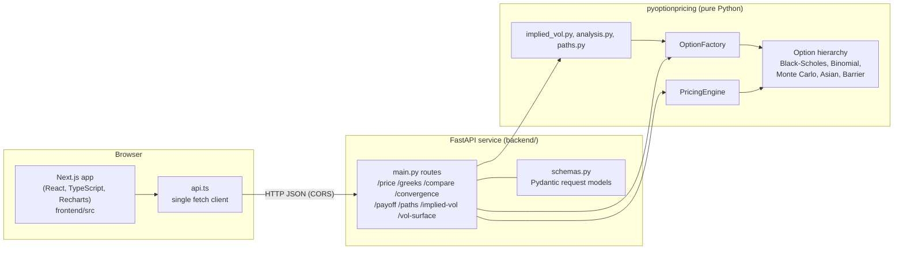
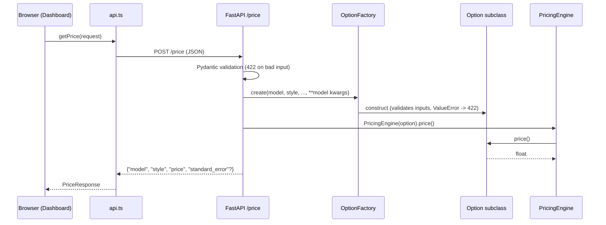

# Architecture

The system has three layers. Each layer depends only on the one below it.

## Request flow (`POST /price`)

## Design rules

- **No model logic in routes.** Each route checks the request, builds options through `OptionFactory`, and calls library functions. All maths lives in `pyoptionpricing`.
- **Model-specific inputs are filtered automatically.** The API reads the constructor signature of the class that the factory resolves. It passes only the inputs that class accepts (for example `steps` for binomial, `barrier` for barrier options) and reports any required inputs that are missing.
- **One error format.** Pydantic validation errors and library `ValueError`s both return HTTP 422. The frontend shows field-level errors under the matching input, and other messages above the button.
- **One fetch client.** Every frontend call goes through `frontend/src/lib/api.ts`.
