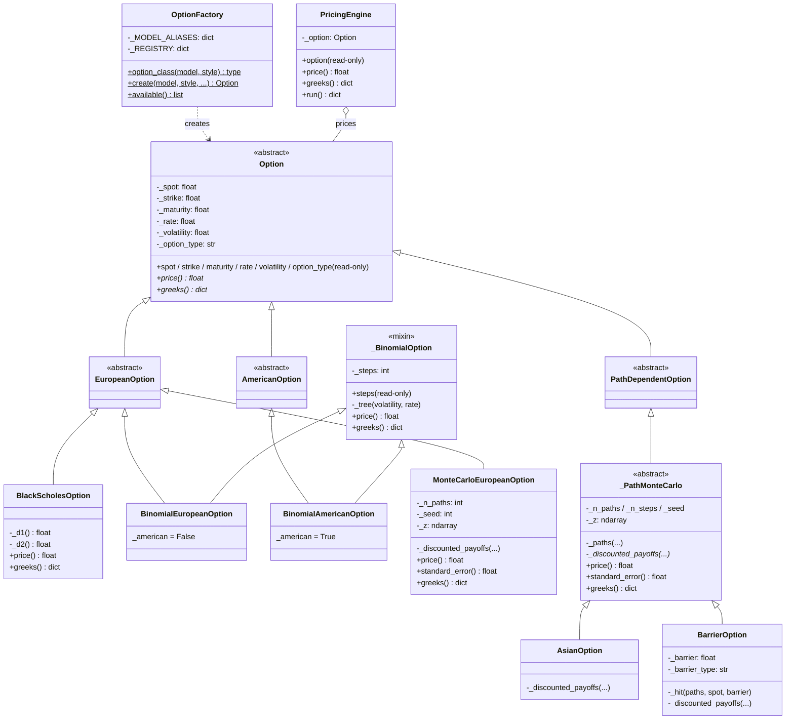

# UML class diagram

The diagram shows the `pyoptionpricing` class hierarchy, the factory, and the pricing engine. Abstract classes are marked `<<abstract>>`. `_BinomialOption` and `_PathMonteCarlo` are internal base classes that hold shared numerical code.

## Supporting modules (functions, not classes)

| Module | Contents |
| --- | --- |
| `paths.py` | `standard_normals`, `simulate_paths` (discrete GBM), `vanilla_payoff` |
| `implied_vol.py` | `implied_volatility` (Brent's method over any model built by the factory), `volatility_smile` |
| `analysis.py` | `binomial_convergence`, `monte_carlo_convergence`, `payoff_curve`, `sample_paths`, `volatility_surface` |

To regenerate a draft from the code: `pip install pylint && pyreverse -o png -p pyoptionpricing pyoptionpricing`.
